<div align="center">

  

  # 🚀 Awesome Productivity &amp; Workspace

  <p align="center">
    <strong>A curated directory of top-tier Local-First, Block-Based, Markdown &amp; Self-Hosted Collaborative Workspace Tools.</strong>
  </p>

  <p align="center">
    <a href="https://github.com/ishandutta2007/Awesome-Awesome-Awesome"></a><a href="https://discord.gg/jc4xtF58Ve"></a>
    <a href="https://github.com/ishandutta2007/Awesome-Productivity-Workspace/stargazers"></a>
    <a href="https://github.com/ishandutta2007/Awesome-Productivity-Workspace/network/members"></a>
    <a href="https://github.com/ishandutta2007/Awesome-Productivity-Workspace/blob/main/LICENSE"></a>
    <a href="https://github.com/ishandutta2007/Awesome-Productivity-Workspace/pulls"></a>
    <a href="https://github.com/ishandutta2007"></a>
  </p>

</div>

---

## 📖 Overview & Architecture Landscape

Modern **productivity workspaces** fuse note-taking, hierarchical wikis, relational databases, kanban boards, and project management into a single unified canvas. Rather than juggling disconnected spreadsheets, documents, and task lists, teams and individuals utilize block-based editors and dynamic views to structure institutional knowledge.

The central trade-off across this software category centers on **data ownership versus collaborative polish**:
- **Commercial SaaS platforms** (Notion, Coda, ClickUp, monday.com) provide effortless real-time multi-user syncing, rich automation ecosystems, and slick user interfaces, but require perpetual subscriptions and store proprietary data schemas in vendor-locked cloud servers.
- **Open-source & Local-First solutions** (AppFlowy, AFFiNE, Memos, Joplin, SiYuan, Logseq, Docmost) prioritize local disk storage, zero-knowledge end-to-end encryption (E2EE), Docker-based self-hosting, and raw Markdown portability—giving knowledge workers absolute sovereignty over their data.

---

## 📑 Table of Contents

- [🌐 Sector Overview & Market Dynamics](#-sector-overview--market-dynamics)
- [☁️ SaaS & Hosted Platforms](#️-saas--hosted-platforms)
- [🔓 Open-Source GitHub Projects (Ranked by Stars)](#-open-source-github-projects-ranked-by-stars)
- [💎 Local-First Proprietary Benchmark](#-local-first-proprietary-benchmark)
- [📊 Architectural Comparison Matrix](#-architectural-comparison-matrix)
- [🤝 How to Contribute](#-how-to-contribute)
- [📈 Star History](#-star-history)
- [💖 Support & Sponsorship](#-support--sponsorship)
- [⚖️ Disclaimer](#️-disclaimer)

---

## 🌐 Sector Overview & Market Dynamics

The global **Productivity and Collaborative Workspace Software market** was valued at approximately **$54.8 Billion in 2024** and is projected to expand to **$102.5 Billion by 2030**, exhibiting a Compound Annual Growth Rate (**CAGR of ~11.0%**). This accelerating demand is driven by distributed hybrid workforces, asynchronous documentation cultures, and the rapid embedding of LLM-based autonomous AI retrieval agents into enterprise wikis.

The industry landscape demonstrates a **two-tier market concentration dynamic**:
1. **Office Suite Infrastructure Layer (Highly Concentrated / Winner-Take-Most)**: Foundational email, office editing, and cloud document storage are overwhelmingly dominated by public cloud hyperscalers—primarily Microsoft (Microsoft 365) and Google (Google Workspace)—due to massive enterprise distribution moats and unified identity (SSO) systems.
2. **Modular Collaborative Workspaces & Knowledge Engines (Moderately Fragmented)**: The specialized sector covering block-based relational docs, team knowledge bases, and personal knowledge management (PKM) remains highly dynamic and competitive. Category frontrunners (Notion, monday.com, ClickUp, Coda) actively compete against an aggressive wave of **local-first and open-source alternatives** (AppFlowy, AFFiNE, Memos, SiYuan, Docmost) fueled by developer resistance to cloud lock-in, data sovereignty regulations (GDPR/HIPAA), and zero-trust security postures.

---

## ☁️ SaaS & Hosted Platforms

The table below catalogs premier commercial SaaS productivity workspaces, sorted in **descending order of parent company size (valuation / market capitalization)**:

| Platform | Company Valuation / Revenue | Starting Tier Price | Free Tier Limit | Core Architecture & Sweet Spot |
| :--- | :--- | :--- | :--- | :--- |
| **[Microsoft OneNote](https://www.microsoft.com/en-us/microsoft-365/onenote)** | **$3.12 Trillion** Market Cap (~$245B ARR) | **$6.99/mo** (Personal) or **$6.00/user/mo** billed annually (Business Basic) | **Free forever**: 5 GB OneDrive cloud storage limit per Microsoft account with cross-device sync. | Free-form infinite canvas with digital ink, audio capture, and seamless native integration across the Microsoft 365 enterprise ecosystem. |
| **[monday.com](https://monday.com/)** | **$14.2 Billion** Market Cap (~$950M ARR) | **$9.00/seat/mo** billed annually ($12.00 billed monthly; 3-seat minimum = $27/mo) for Basic plan | **Free forever**: Up to 2 team seats, 3 active boards, 200+ templates, and 500 MB cloud file storage. | Visual Work OS emphasizing relational column types, sprint planning, project dashboards, and automated status pipelines. |
| **[Notion](https://www.notion.com/)** | **$10.0 Billion** Valuation (~$250M ARR) | **$10.00/member/mo** billed annually ($12.00 billed monthly) for Plus plan | **Free forever**: Unlimited blocks for individuals, up to 10 guest collaborators, 5 MB file upload limit per file, 7-day page history. | The industry benchmark for all-in-one relational databases, rollups, kanban boards, wikis, and AI document synthesis. |
| **[ClickUp](https://clickup.com/)** | **$4.0 Billion** Valuation (~$175M ARR) | **$7.00/user/mo** billed annually ($10.00 billed monthly) for Unlimited plan | **Free forever**: 100 MB cloud storage limit, unlimited tasks, unlimited team members, 100 custom field uses, 100 automations/mo. | All-in-one project management and workspace suite featuring 15+ views, native time tracking, sprint points, and nested docs. |
| **[Evernote](https://evernote.com/)** | **$2.55 Billion** Valuation (Parent: Bending Spoons; ~$100M ARR) | **$14.99/mo** ($129.99/year) for Evernote Personal | **Free forever**: Capped strictly at 50 total notes, 1 notebook, 1 single active synced device, and 25 MB max note size (60 MB/mo upload). | Pioneer note capture system featuring high-fidelity web clipper, optical character recognition (OCR) for handwritten notes, and PDF search. |
| **[Coda](https://coda.io/)** | **$1.4 Billion** Valuation (~$50M ARR) | **$10.00/Doc Maker/mo** billed annually ($12.00 billed monthly) for Pro plan (Viewers & Editors are free) | **Free forever**: Up to 50 doc objects (tables, views, buttons, formulas) per document, unmetered viewing & editing, 1 GB storage limit, 35 automations/mo. | Document-software hybrid enabling teams to build interactive internal apps with programmable buttons, rich formulas, and two-way integration Packs (Slack, Jira, Stripe). |
| **[Craft](https://www.craft.do/)** | **~$60 Million** Valuation ($16.8M funding raised) | **$8.00/member/mo** billed annually ($10.00 billed monthly) for Plus plan | **Free forever**: Up to 1,000 document blocks, 1 GB storage, 2 team members, and 30-day version history. | Native Apple-first aesthetic with lightning-fast nested card structures, high-performance offline caching, and publication-ready export typography. |
| **[Slite](https://slite.com/)** | **~$25 Million** Valuation ($15.3M funding raised) | **$8.00/user/mo** billed annually ($10.00 billed monthly) for Standard plan | **Free forever**: Up to 50 total documents, standard block editor, 1 active user; or 14-day free trial for full team workspaces. | Distraction-free team knowledge base designed around clean documentation, asynchronous discussions, and AI-powered question answering. |

---

## 🔓 Open-Source GitHub Projects (Ranked by Stars)

A curated compilation of top self-hostable, local-first, and open-source productivity workspaces, **sorted in descending order by GitHub stargazers**:

### 1. [AppFlowy](https://github.com/AppFlowy-IO/AppFlowy) [](https://github.com/AppFlowy-IO/AppFlowy/stargazers)
- **License**: AGPL-3.0
- **Technology Stack**: Rust, Flutter, Go, PostgreSQL, Redis, MinIO
- **Key Capabilities**: The leading open-source Notion alternative. Features complete offline capability by default, grid, board, calendar, and document views, customizable filters, and self-hosted AppFlowy Cloud via Docker Compose. Ensures instant page loads because data resides on your local hardware.

### 2. [AFFiNE](https://github.com/toeverything/AFFiNE) [](https://github.com/toeverything/AFFiNE/stargazers)
- **License**: Community Edition (Source Available / Open Core)
- **Technology Stack**: TypeScript, Rust (OctoBase), WebAssembly, React
- **Key Capabilities**: The next-generation docs-plus-whiteboard hybrid. Unifies structured block document editing with an edgeless whiteboard canvas for mind maps, sticky notes, and sketches. Local-first CRDT synchronization across desktop and web with self-hostable Docker deployment.

### 3. [Memos](https://github.com/usememos/memos) [](https://github.com/usememos/memos/stargazers)
- **License**: MIT
- **Technology Stack**: Go, TypeScript, React, SQLite / PostgreSQL
- **Key Capabilities**: Ultra-lightweight, privacy-first, self-hosted note-taking service and micro-journal. Features a personal timeline, rich Markdown formatting, tag-based categorization, REST APIs, and instant single-binary or single-container Docker deployment.

### 4. [Joplin](https://github.com/laurent22/joplin) [](https://github.com/laurent22/joplin/stargazers)
- **License**: MIT
- **Technology Stack**: TypeScript, Electron, React Native, SQLite
- **Key Capabilities**: The definitive open-source Evernote replacement. Supports end-to-end encrypted (E2EE) synchronization via Nextcloud, Dropbox, WebDAV, OneDrive, or self-hosted Joplin Server. Offers native desktop and mobile apps, full-text search, plugins, and web clipper.

### 5. [SiYuan](https://github.com/siyuan-note/siyuan) [](https://github.com/siyuan-note/siyuan/stargazers)
- **License**: AGPL-3.0
- **Technology Stack**: Go, TypeScript, Electron, SQLite
- **Key Capabilities**: Privacy-first, local-first personal knowledge workspace built on a granular block-level reference architecture. Includes bidirectional linking, SQL-based database queries, graph visualization, PDF annotation, and built-in end-to-end cloud sync with self-hosting support.

### 6. [Logseq](https://github.com/logseq/logseq) [](https://github.com/logseq/logseq/stargazers)
- **License**: AGPL-3.0
- **Technology Stack**: Clojure, ClojureScript, Electron, Datascript
- **Key Capabilities**: Outliner-first knowledge management system built on local plain-text Markdown and Org-mode files. Emphasizes daily journals, bi-directional backlinks, flashcards (spaced repetition), and queries without vendor lock-in.

### 7. [Outline](https://github.com/outline/outline) [](https://github.com/outline/outline/stargazers)
- **License**: BSL 1.1 / Open Core
- **Technology Stack**: Node.js, TypeScript, React, PostgreSQL, Redis, S3
- **Key Capabilities**: Fast, modern, and beautiful collaborative knowledge base and wiki for growing teams. Features a clean markdown-compatible editor, enterprise SSO (Google, Okta, OIDC, Slack), granular permission hierarchies, and complete audit logging.

### 8. [Trilium Notes](https://github.com/TriliumNext/Trilium) [](https://github.com/TriliumNext/Trilium/stargazers)
- **License**: AGPL-3.0
- **Technology Stack**: JavaScript, Node.js, SQLite, Electron
- **Key Capabilities**: Hierarchical note-taking application designed for building large-scale personal knowledge bases. Features deep note trees, note cloning, scripting via JavaScript APIs, mind maps, relationship diagrams, and automated desktop-to-server sync.

### 9. [Docmost](https://github.com/docmost/docmost) [](https://github.com/docmost/docmost/stargazers)
- **License**: AGPL-3.0
- **Technology Stack**: NestJS, TypeScript, React, PostgreSQL, Redis
- **Key Capabilities**: Open-source collaborative wiki and documentation software engineered as a modern alternative to Confluence and Notion. Provides real-time multiplayer editing, nested page trees, markdown shortcuts, file attachments, and lightweight Docker hosting.

### 10. [Foam](https://github.com/foambubble/foam) [](https://github.com/foambubble/foam/stargazers)
- **License**: MIT
- **Technology Stack**: TypeScript, VS Code Extension ecosystem, Markdown
- **Key Capabilities**: A personal knowledge management and sharing system inspired by Roam Research, built directly into Visual Studio Code. Uses raw Markdown files on disk, Git for version control and backup, and graph visualization for interconnected thoughts.

### 11. [Notesnook](https://github.com/streetwriters/notesnook) [](https://github.com/streetwriters/notesnook/stargazers)
- **License**: GPL-3.0
- **Technology Stack**: TypeScript, React, React Native, SQLite
- **Key Capabilities**: Fully open-source and zero-knowledge end-to-end encrypted note-taking application. Protects notes with client-side encryption, biometric locks, export to PDF/Markdown, and full multi-device synchronization without tracking or telemetry.

### 12. [Anytype](https://github.com/anyproto/anytype-ts) [](https://github.com/anyproto/anytype-ts/stargazers)
- **License**: AGPL-3.0
- **Technology Stack**: Go (anytype-heart), TypeScript, Electron
- **Key Capabilities**: Local-first, peer-to-peer encrypted operating environment for thoughts and docs. Uses an object-oriented graph data model (pages, tasks, sets, relations) operating seamlessly offline and syncing via local network or encrypted backup nodes.

### 13. [HedgeDoc](https://github.com/hedgedoc/hedgedoc) [](https://github.com/hedgedoc/hedgedoc/stargazers)
- **License**: AGPL-3.0
- **Technology Stack**: Node.js, TypeScript, React, PostgreSQL / MariaDB
- **Key Capabilities**: Self-hosted, real-time collaborative Markdown editor (formerly CodiMD). Enables concurrent team editing of technical specifications, meeting minutes, and presentations with slide mode, MathJax/LaTeX, and diagram support.

### 14. [Dendron](https://github.com/dendronhq/dendron) [](https://github.com/dendronhq/dendron/stargazers)
- **License**: Apache-2.0
- **Technology Stack**: TypeScript, VS Code Extension
- **Key Capabilities**: Hierarchical note-taking tool that grows alongside your knowledge base. Combines the freedom of linking with the structure of schemas, enabling fast refactoring, flexible publishing, and full Git synchronization.

### 15. [Standard Notes](https://github.com/standardnotes/app) [](https://github.com/standardnotes/app/stargazers)
- **License**: AGPL-3.0
- **Technology Stack**: TypeScript, React, Ruby on Rails (Sync Server), SQLite
- **Key Capabilities**: Ultra-secure, privacy-focused note-taking application. Free tier offers lifetime end-to-end encryption with unlimited cross-device sync, offline access, and PIN protection, while paid tiers add rich text, code editors, and spreadsheets.

### 16. [SilverBullet](https://github.com/silverbulletmd/silverbullet) [](https://github.com/silverbulletmd/silverbullet/stargazers)
- **License**: MIT
- **Technology Stack**: TypeScript, Deno, WebAssembly, Lua
- **Key Capabilities**: An extensible, open-source personal knowledge base powered by plain Markdown files. Features an in-browser editor with live queries, embedded templates, client-side offline execution, and scripting via Lua.

### 17. [Alexandrie](https://github.com/Smaug6739/Alexandrie) [](https://github.com/Smaug6739/Alexandrie/stargazers)
- **License**: MIT
- **Technology Stack**: TypeScript, Next.js, CodeMirror 6, Docker, MinIO / S3
- **Key Capabilities**: Lightweight, offline-first Markdown knowledge base with deep technical writing capabilities. Supports interactive LaTeX, diagrams, multi-tenant teams, OIDC single sign-on, full-text indexing, and automated S3 backups.

---

## 💎 Local-First Proprietary Benchmark

While not licensed under an open-source license, **[Obsidian](https://obsidian.md/)** represents the gold-standard proprietary benchmark for the local-first movement:
- **Architecture**: Proprietary Electron/Node.js desktop and mobile app built entirely on **plain Markdown text files stored directly on your local hard drive**.
- **Pricing**: Completely **free for personal use** with no functional limits; optional end-to-end encrypted **Obsidian Sync at $4/user/mo** (billed annually) and **Obsidian Publish at $8/site/mo**.
- **Ecosystem**: Over 2,000 community plugins (Dataview, Canvas, Excalidraw, Calendar) allowing users to construct custom database query layers and visual workspaces while retaining 100% data ownership.

---

## 📊 Architectural Comparison Matrix

| Project | Primary License | Primary Data Paradigm | Offline & Sync Model | Self-Hosting Stack | Best Architectural Fit |
| :--- | :--- | :--- | :--- | :--- | :--- |
| **AppFlowy** | AGPL-3.0 | Relational Block Databases | Local SQLite + WebSocket Sync | Docker: Postgres, Redis, MinIO | Teams seeking a drop-in self-hosted Notion alternative with relational views |
| **AFFiNE** | Open Core | Docs + Infinite Canvas Hybrid | Local-First (OctoBase CRDTs) | Docker Compose + Node backend | Users requiring both document writing and visual whiteboard brainstorming |
| **Memos** | MIT | Social Timeline & Micro-notes | Server-backed REST API / PWA | Single Docker container + SQLite | Developers wanting lightweight, frictionless thought capture and daily logs |
| **Joplin** | MIT | Hierarchical Notebooks & Tags | Local SQLite + Multi-Cloud Sync | Joplin Server or Nextcloud/WebDAV | Users migrating away from Evernote needing reliable E2EE cross-device sync |
| **SiYuan** | AGPL-3.0 | Granular Block Graph Model | Local SQLite + WebDAV/S3 E2EE | Single Docker image / Go binary | Power users wanting bidirectional linking, SQL queries, and deep knowledge networks |
| **Logseq** | AGPL-3.0 | Journal Outliner & Network Graph | Local Markdown / Org Files | Desktop App / Git Versioning | Individual knowledge workers practicing networked thought and daily journaling |
| **Outline** | BSL 1.1 | Structured Wiki & Knowledge Base | Client-Server API with Caching | Node.js, Postgres, Redis, S3 | Fast-growing teams needing an enterprise Confluence alternative with clean UX |
| **Trilium Notes** | AGPL-3.0 | Deep Hierarchical Tree & Clones | Local SQLite + Desktop Sync | Node.js + SQLite Docker container | Technical users organizing tens of thousands of deeply nested technical notes |
| **Docmost** | AGPL-3.0 | Multiplayer Team Docs & Wiki | Real-time WebSockets + Postgres | Docker Compose: Node, Postgres, Redis | Small-to-medium teams looking for a clean, self-hosted Notion/Confluence wiki |
| **Notesnook** | GPL-3.0 | Encrypted Rich Notebooks | Local Storage + Zero-Knowledge E2EE | Self-hosted Sync Server | Privacy advocates seeking verified zero-knowledge notes with mobile apps |
| **Standard Notes** | AGPL-3.0 | Minimalist Encrypted Plaintext | Local Cache + E2EE Sync Engine | Docker: Rails, MySQL, Redis | Maximum security minimalists who never want encryption tiered behind paywalls |

---

## 🤝 How to Contribute

Contributions and ecosystem additions are warmly welcomed!

1. **Fork the repository** to your personal GitHub profile.
2. **Create a descriptive topic branch**:
   ```bash
   git checkout -b feat/add-productivity-tool
   ```
3. **Commit your additions** ensuring accurate pricing details, free tier boundaries, and verified star badges.
4. **Push your branch** and **open a Pull Request** with a succinct description of the platform added.

---

## 📈 Star History

[](https://star-history.dera.page/#ishandutta2007/Awesome-Productivity-Workspace&type=date&legend=top-left)

---

## 💖 Support & Sponsorship

If you find this curated ecosystem directory valuable for your personal workflow, team collaboration, or data privacy research, please consider supporting its continuous maintenance:

- ⭐ **Star this repository** on GitHub to amplify its reach!
- 🍴 **Fork the repo** to keep a personal reference copy.
- 📢 **Share with fellow developers**, knowledge workers, and privacy advocates.
- ☕ **Support continuous maintenance & research** by sponsoring via the link below:

<p align="center">
  <a href="https://github.com/sponsors/ishandutta2007">
    
  </a>
</p>

---

## ⚖️ Disclaimer

- This repository is a **community-curated directory** created for educational, research, and comparative purposes. Mention of specific platforms or commercial products does not constitute an official endorsement.
- Cloud vendor pricing plans and tier limits fluctuate: always verify pricing on official vendor websites prior to enterprise procurement.
- When self-hosting open-source solutions, remember that operational responsibility shifts to your infrastructure team—ensure regular database snapshots, TLS certificate renewal, and secure off-site backups.

---

<p align="center">
  <strong>Crafted with ❤️ for knowledge workers, developers, and teams building workspaces they can truly own.</strong>
</p>
